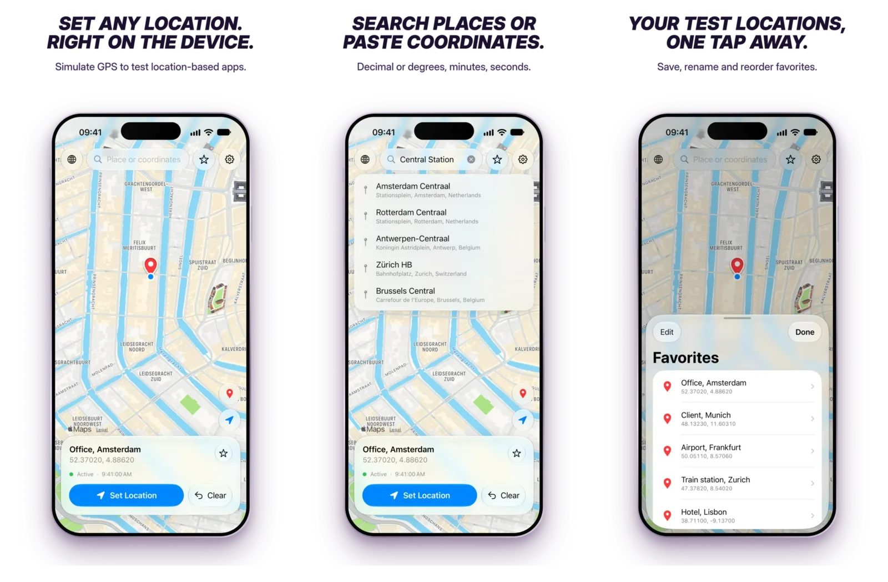

# LocSim

[](https://github.com/Rockykln/locsim/actions/workflows/build.yml)


[](LICENSE)

Simulate the GPS location of an iPhone directly on the device, without a computer
attached. Intended for developing and testing location-based apps.

LocSim opens a RemoteXPC tunnel to the iPhone it runs on, through a loopback VPN,
and drives the same DVT location simulation service that Xcode uses.

<p align="center">
  <picture>
    <source media="(prefers-color-scheme: dark)" srcset="docs/images/screenshots-dark.webp">
    
  </picture>
</p>

## Features

- Set a location by long-pressing the map, searching for a place or entering
  coordinates (`48.8566, 2.3522`, `48,8566 2,3522`, `48°51'23.8"N 2°21'07.9"E`)
- Favorites with rename, reorder and copy
- Keeps the simulated location while the app is in the background
- Reuses an existing tunnel after switching from Wi-Fi to cellular
- Installs the Developer Disk Image on demand when it is not mounted
- Restores the real location on Clear, Stop and Quit or when the app is closed
- English and German; the language follows *Settings > Apps > LocSim > Language*

## How it works

```
LocSim ──TCP──▶ 10.7.0.1:<port> ──LocalDevVPN──▶ remotepairingd (same iPhone)
                                                   │ RPPairing + RemoteXPC tunnel
                                                   ▼
                                     com.apple.instruments.dtservicehub
                                     (DVT LocationSimulation)
```

1. The tunnel is opened on the default RPPairing port 49152. If that fails, the
   port is discovered via Bonjour (`_remotepairing._tcp`), as it can differ on
   some devices.
2. [idevice](https://github.com/jkcoxson/idevice) performs pair-verify with the
   imported RPPairing file and builds the tunnel.
3. If the Developer Disk Image is missing it is installed (cryptex on iOS 26.4+,
   personalized image before).
4. The location is sent over DVT and resent periodically. iOS resets it as soon
   as the connection closes.

## TestFlight

Beta builds are available through TestFlight on request.
[Request access by email](mailto:locsim@rockykln.com?subject=LocSim%20beta%20access%20request&body=Hello%2C%0A%0AI%20would%20like%20to%20join%20the%20LocSim%20beta%20on%20TestFlight.%0A%0AName%3A%0AApple%20ID%20email%20for%20the%20invite%3A%0ADevice%20%28for%20example%20iPhone%2016%20Pro%29%3A%0AiOS%20version%20%28Settings%20%3E%20General%20%3E%20About%29%3A%0AWhat%20I%20want%20to%20test%20with%20LocSim%3A%0A%0A%5B%20%5D%20Developer%20Mode%20is%20enabled%20on%20the%20device%0A%5B%20%5D%20I%20can%20create%20a%20pairing%20file%20with%20a%20Mac%2C%20Windows%20or%20Linux%20computer%0A%0AThanks%0A) and fill in the prepared fields.

## Requirements

- iPhone on iOS 17.4 or later
- [LocalDevVPN](https://apps.apple.com/app/localdevvpn/id6755608044) from the App Store
- Wi-Fi only while the connection is established (any network, no internet
  required). Once connected, locations can be changed on cellular.
- A Mac, Windows or Linux computer once, for Developer Mode and the pairing file

## Installation

Join the [TestFlight beta](#testflight), or build and install LocSim with Xcode,
see [Building](#building). With a free
Apple ID the app expires after 7 days and has to be run from Xcode again.

## Setup

Follow the [setup guide](https://locsim.rockykln.com/setup/): enable Developer Mode,
allow connections over Wi-Fi, create a pairing file and import it into LocSim. From a
clone of this repository, create the file with `tools/make-pairing.sh` or, on Windows,
`tools\make-pairing.ps1`.

## Usage

1. Join any Wi-Fi network and connect LocalDevVPN (default addresses
   `10.7.0.1` / `10.7.1.1`; allow the VPN configuration on first use).
2. Open LocSim and allow Local Network access, which is needed to find the
   pairing port. Location access is optional and only used for the background
   keep-alive and for showing your real position.
3. Long-press the map, search for a place or enter coordinates, then
   *Set Location*.
4. *Clear* restores the real location. Long-press *Clear* or use *Settings >
   Stop and Quit* to end the app completely.

Wi-Fi is only needed for step 3 the first time, when the connection is built.
While it stays open, new locations can be set without Wi-Fi. After *Clear* or
closing the app, the next connection needs Wi-Fi again.

After a restart, only LocalDevVPN has to be reconnected. A new pairing file is
needed after an iOS update, a device reset or after clearing trusted computers.

## Building

Requires Xcode and [XcodeGen](https://github.com/yonaskolb/XcodeGen).

```
curl -fLO https://github.com/jkcoxson/idevice/releases/download/v0.1.68/idevice-xcframework-v0.1.68.zip
unzip -q idevice-xcframework-v0.1.68.zip
mkdir -p Frameworks && mv swift/IDevice.xcframework Frameworks/ && rm -rf swift idevice-xcframework-v0.1.68.zip
echo "DEVELOPMENT_TEAM = <your team id>" > Config/Local.xcconfig
xcodegen generate
open LocSim.xcodeproj
```

The team ID is the 10-character value after `OU=` in
`security find-certificate -c "Apple Development" -p | openssl x509 -noout -subject`.
`Config/Local.xcconfig` is ignored by git. Run `xcodegen generate` again after
pulling changes. The build commit is stamped into the app by a scheme pre-action
and shown under *Settings > About*.

GitHub Actions checks that every push and pull request builds. TestFlight
uploads are described in [docs/RELEASING.md](docs/RELEASING.md).

## Project layout

```
LocSim/
  App/        App entry and lifecycle
  Device/     idevice bridge, port discovery, pairing and DDI storage
  Session/    Spoofing state, keep-alive, search, settings
  Views/      SwiftUI screens
Config/       Shared xcconfig, local overrides are git-ignored
tools/        Pairing file creation (macOS, Linux, Windows)
```

## Troubleshooting

Errors show a code in the status line; tap it for details and *Copy Details* for a
support request. The technical log is under *Settings > Log*.

| Code | Meaning | What to do |
| --- | --- | --- |
| LS-100 | No pairing file | Import one under *Settings > Pairing* |
| LS-101 | Pairing file not valid | Create a new one with `tools/make-pairing.sh` |
| LS-102 | Lockdown pairing file | LocSim needs an RPPairing file from `tools/make-pairing.sh` |
| LS-200 | Invalid target address | Reset the target IP to `10.7.0.1` |
| LS-201 | Device not reachable | Connect LocalDevVPN |
| LS-202 | Pairing service unavailable | Check LocalDevVPN, join Wi-Fi, enable *Show this iPhone when on Wi-Fi* |
| LS-203 | Pairing rejected | Create a new pairing file, e.g. after an iOS update |
| LS-204 | Connection lost | Tap *Set Location* to reconnect |
| LS-300 | Developer Disk Image not available | Check that Developer Mode is on |
| LS-301 | Download failed | Check the internet connection |
| LS-302 | Developer Disk Image not installed | Retry with an internet connection |
| LS-400 | Location service unavailable | Turn on *Mount Automatically* or restart the device |
| LS-401 | Location not set | Try again |
| LS-402 | Location not cleared | Close LocSim to restore the real location |
| LS-900 | Unexpected error | Send the copied details |

## Privacy

LocSim has no analytics and no accounts. Network traffic goes to the device
itself, Apple Maps for map tiles and search, GitHub when the Developer Disk Image
is downloaded and Apple's signing server when it is installed.

## Disclaimer

LocSim is a development tool. Using a simulated location may violate the terms of
other apps and services; you are responsible for how you use it. This project is
not affiliated with or endorsed by Apple.

## Acknowledgements

- [idevice](https://github.com/jkcoxson/idevice) by Jackson Coxson, MIT
- [DeveloperDiskImage](https://github.com/doronz88/DeveloperDiskImage) by doronz88
- [StikDebug](https://github.com/StikDebug/StikDebug), which showed the on-device
  approach

See [THIRD_PARTY_NOTICES.md](THIRD_PARTY_NOTICES.md).

## License

[MIT](LICENSE)
