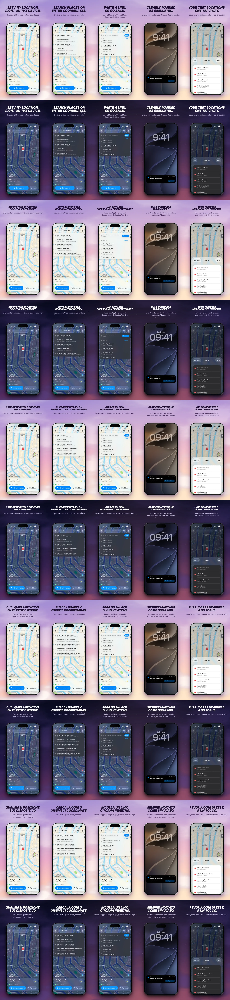

# Mockups

`render.py` builds the App Store images and the README image from the screenshots in
`design/screenshots/`, with the texts from `slides.json`, in English, German, French, Spanish and
Italian, light and dark. `render.py --web-assets` builds the website images.

The sky, clouds, stars and phone frame are generated, so there are no stock
photos or device artwork to license. The background is one panorama across all
slides and joins up in the App Store. Title font: Inter (`fonts/`, SIL OFL 1.1).

1. On the Mac, run `tools/screenshots.sh` (or `tools/screenshots.sh de fr` for some
   languages). It builds a Debug build for the iOS Simulator, sets the status bar to 9:41
   and saves five screens per language and theme to `design/screenshots/<lang>/<theme>/`
   (not committed). The app runs in demo mode (`-demo map|search|recents|live|favorites`):
   sample places in the app's language, an active location, no device connection,
   nothing saved. Release builds ignore the argument.
   For the Lock Screen with the Live Activity (`4-live`) the script waits until you lock
   the Simulator (Cmd-L). Each language restarts the Simulator in that system language,
   since the Live Activity follows it. The first run may ask whether LocSim may show
   Live Activities: allow it once and run that language again.
2. Run `design/mockups/render.py` (needs Firefox, ImageMagick 7 and oxipng or optipng).
   `--lang de,fr` renders only some languages, `--jobs N` sets how many images are rendered
   at once (default: half the CPU cores, at most 4). Titles are measured and get one size
   per language. A render that fails stops the run with an error instead of keeping an old
   image; images that have not started yet are skipped.
3. App Store images land in `design/mockups/out/` (6.9", 1320 × 2868) and `out/6.3/`
   (1206 × 2622, the size App Store Connect requires), neither committed. The README
   images land in `docs/images/`: `screenshots-<theme>.webp` with all README slides and
   `screenshots-<theme>-narrow.webp` with only the first and the last of them, for phones.
   `--readme-only` renders only what they need.
4. For the website, run `render.py --web-assets`. It writes the sky and, for the slides
   marked `"site": true`, the phones without text or shadow to `site/public/img/` as
   `phone-<slide id>-<lang>-<theme>.webp`. `--lang` and `--jobs` work here too. The texts
   are HTML in the pages.

`preview.webp` shows all App Store images at a glance (one row per language and theme)
and is updated whenever all five languages are rendered. The README images use the slides
marked `"readme": true`, or all slides if none is marked.

Screenshots directly in `design/screenshots/` work for all variants. Missing ones are
rendered as a grey placeholder.
